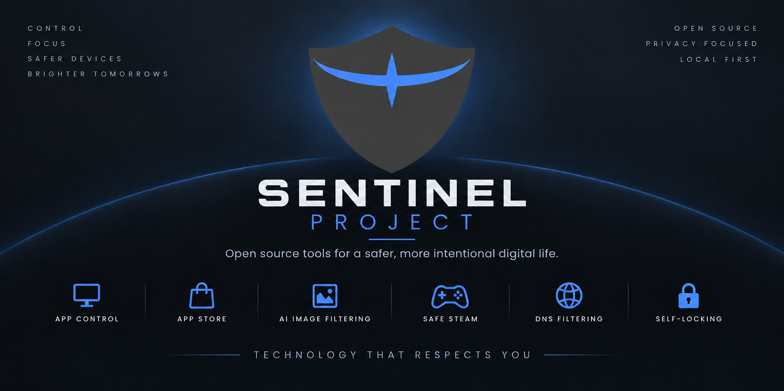
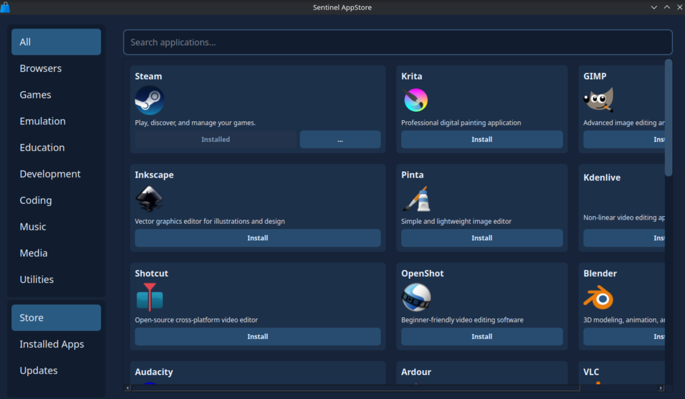
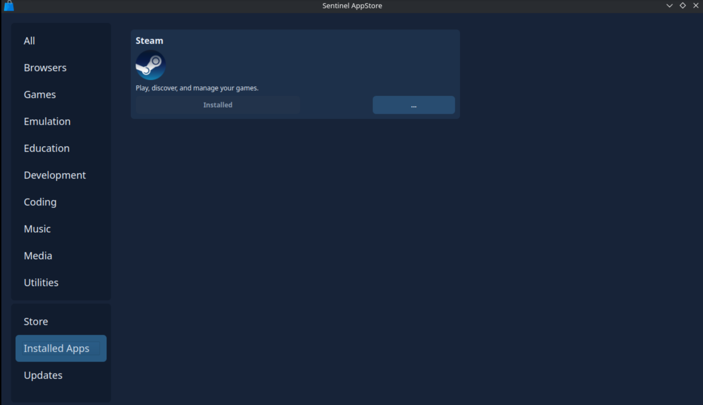
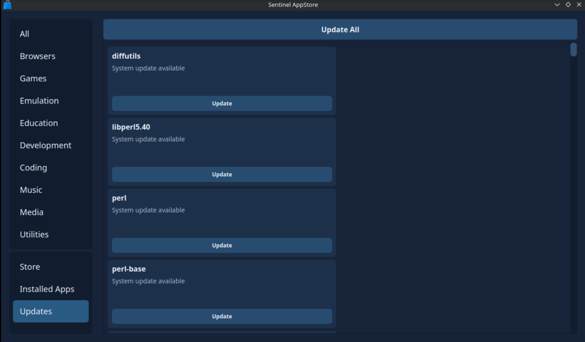
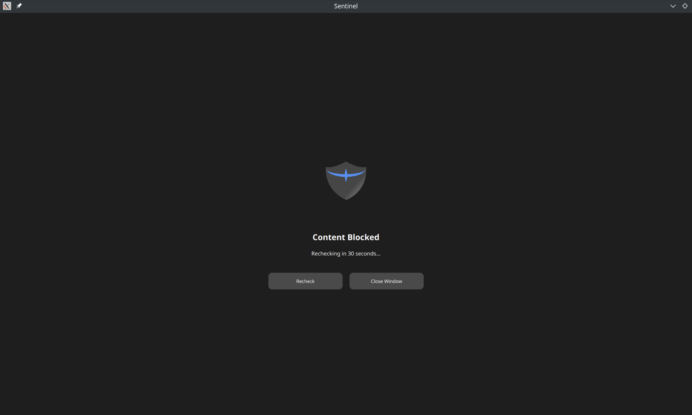
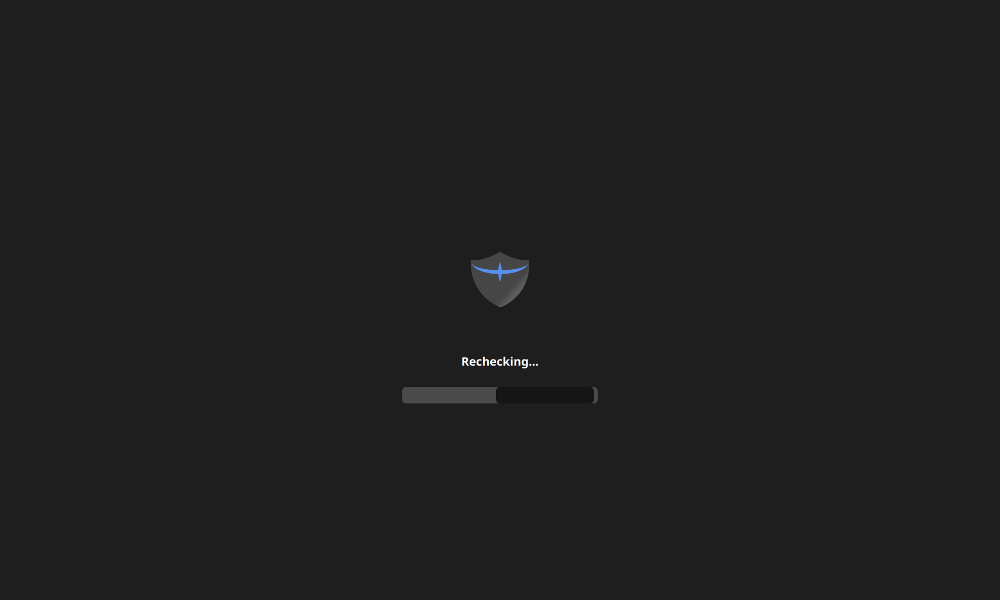
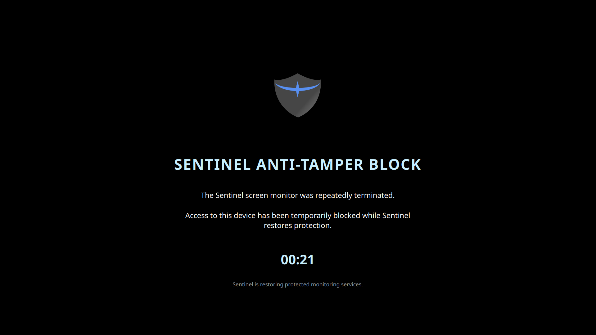

<p align="center">
  
</p>

# Sentinel

Sentinel is a local-first platform for digital wellbeing, content filtering,
parental controls, and permanent voluntary restrictions. The current desktop
implementation targets **Kubuntu, KDE Plasma, Wayland/KWin, and one protected
non-root desktop account**. Native Google Chrome Stable is the supported browser.

The desktop features are implemented and under development. Initial Debian
package definitions and build automation target Kubuntu 26.04 amd64; see the
[packaging guide](docs/debian-packaging.md). Test ISO integration and signed APT
update tooling are available; production hosting, hardware validation and
final release hardening remain deployment work. This checkout
is not a finished distribution or a complete bypass-proof sandbox.

## Sentinel Portal

Manage protections, focus windows, and lock modes from one desktop app.


<details>
<summary>View protection settings, calendar, lock modes, and Guardian controls</summary>

### Protections

Configure image filtering and device/browser protections.


### Calendar

Plan focus windows for apps, websites, or the whole desktop.


### Lock modes

Choose Unlocked, permanent Self-Lock, or Guardian Lock.


### Guardian controls

Manage approved apps, websites, extensions, and the Guardian PIN.


</details>

See the [Portal guide](sentinel/portal/README.md) for the complete gallery and controls.

## Sentinel App Store

Browse applications by category, manage installed apps, and install available updates.



<details>
<summary>View installed apps and available updates</summary>

### Installed apps

View installed applications and their management controls.



### Updates

Install individual updates or use Update All.



</details>

See the [App Store guide](sentinel/appstore/README.md) for the complete gallery and installation policy.

## Screen protection

Sentinel shows a blocked-window page when image filtering detects restricted
content, covers the screen during rechecks, and has a separate anti-tamper screen
for restoring protection after repeated monitor termination.

<details>
<summary>View blocked-window, rechecking, and anti-tamper screens</summary>

### Content blocked

The blocked-window page offers a recheck countdown, Recheck, and Close Window.



### Rechecking

The privacy overlay covers the desktop while Sentinel checks the window again.



### Anti-tamper protection

A separate full-desktop screen appears while Sentinel restores protection after
the screen monitor has been repeatedly terminated.



</details>

See the [screen blocker guide](sentinel/image_blocking/screen_blocker/README.md)
and [monitor lifecycle guide](sentinel/daemon/IMAGE_FILTERING.md#anti-tamper-screen).

## Current features

- **Sentinel Portal:** protections, app/website blocks, calendar, activity,
  daily screen-time allowance, desktop preferences, and lock management.
- **Lock modes:** Unlocked, permanent Self Lock, and Guardian Lock with a PIN
  created and confirmed on every entry from Unlocked. There is no default PIN.
- **Protected backend:** `sentineld` authenticates clients, applies policy,
  performs privileged operations, and supervises desktop components.
- **`sen` CLI:** controlled packages, updates, services, settings, DNS,
  schedules, activity reports, and Guardian app/website controls.
- **App Store:** approved or full Flathub catalogs, native Steam, installs,
  removals, and system/Flatpak updates through the backend.
- **DNS and browser filtering:** AdGuard Home categories, custom domain lists,
  Google SafeSearch, YouTube Moderate Restricted Mode, and a fixed baseline
  restricting known alternative browsers/search engines.
- **App blocking:** AppArmor and process enforcement for native, Flatpak, and
  Snap targets, plus separate Guardian selections of allowed GUI apps.
- **Guardian website access:** allow only selected domains in managed Chrome;
  other active restrictions still apply.
- **Image filtering:** local model services, KWin window capture, per-window
  quarantine, covered rechecks, and monitor supervision/anti-tamper handling.
- **Safe Steam and Safe Crunchyroll:** managed page filters; native Steam also
  has protected extension provisioning and integrity checks.
- **Browser extensions:** approved catalog, Guardian approvals, and an optional
  themed New Tab page with website shortcuts.
- **Screen time:** one-time or recurring app/website/full-desktop blocks,
  a daily allowance, and controlled bypass/extension behavior.
- **Activity:** seven-day local metadata and approximate foreground app/site
  usage reports. Screenshots are not stored in the Activity database.
- **Boot media protection:** optional USB raw-write and desktop elevation
  restrictions; firmware boot restrictions require separate setup.
- **VM protection:** optional KVM/device restrictions and known VM tool blocks;
  see the enforcement inventory and boundaries below.

## Lock behavior

| Mode | Behavior |
| --- | --- |
| Unlocked | Change registered protections and use permitted administrative operations. |
| Self Lock | Permanent through the ordinary interface; maintain or strengthen protections. Package removal and potentially weakening desktop/service changes are denied. |
| Guardian Lock | Protected changes require the Guardian PIN. Exit to Unlocked before entering Self Lock. |

Scheduled windows have their own commitments. Guardian-owned schedules still
require the PIN after leaving Guardian Lock. Narrow exceptions allow correction
of new custom DNS blocks within 24 hours and a two-minute screen-time extension;
these do not unlock other protections. See the component guides below.

## Commands

Run desktop clients as the normal user on an already configured Sentinel system:

```bash
sen man
sen --help
sen state
sentinel-portal
sentinel-appstore
sen activity screen-time --timezone America/Chicago
```

The manual command is `sen man`. Use `sen <command> --help` for exact options.
Source equivalents are `.venv/bin/python -m sen.cli.sen`,
`.venv/bin/python -m sentinel.portal.main`, and
`.venv/bin/python -m sentinel.appstore.main`.

## Development runtime

For a new development PC and the full build workflow, start with
[Development PC → Debian packages → ISO](docs/development-to-iso.md). The steps
below are the shorter loop for an already configured protected runtime.

`pyproject.toml` requires Python **3.14**, excluding 3.14.1. Poetry manages the
project dependencies and builds the `sen` wheel. GUI clients, the root backend,
and model services need their appropriate installed dependencies.

The existing protected installation uses `/usr/lib/sentinel/venv`, the `sentinel`
control group, and `/etc/sentinel/daemon.toml` containing
`protected_user = "your-desktop-user"`. The account must belong to that group.
Configuration, executable runtime, and enforcement assets must be protected
from desktop-user writes. AdGuard must be installed and the OS resolver must
actually send queries to it; generating DNS rules alone does not route DNS.

For an **existing development installation**, stop its daemon before replacing
the wheel: Ctrl+C in its foreground terminal, or
`sudo systemctl stop sentineld.service` for a service instance. Then:

```bash
cd ~/Sentinel_Project
poetry build -f wheel
sudo /usr/lib/sentinel/venv/bin/python -m pip install \
  --no-deps --force-reinstall dist/sen-0.1.0-py3-none-any.whl
```

Start one foreground development daemon:

```bash
sudo /opt/AdGuardHome/AdGuardHome -s start
sudo env SENTINEL_DEV_ALLOW_FIREFOX=1 \
  /usr/lib/sentinel/venv/bin/python -I -m sentinel.daemon.server
```

The Firefox override belongs only to development; omit it for the supported
Chrome-only baseline. This command runs the installed wheel, so changing the
checkout alone does not update that backend. For an installed service deployment,
use `sudo systemctl restart sentineld.service` instead of a second foreground
instance. These commands are not a fresh-machine installer.

Run relevant tests from the project environment:

```bash
QT_QPA_PLATFORM=offscreen .venv/bin/python -m pytest \
  sentinel/daemon/tests sentinel/portal/tests sentinel/appstore/tests -q
```

Live KDE, AppArmor, Chrome, USB, and DNS-routing checks are also needed before
shipping. Independent sudo, Polkit, package-management, execution, alternate
sessions, and firmware boot routes need final distribution integration.

## Component guides

Developers using coding agents can start with [AGENTS.md](AGENTS.md) and the
[LLM project map](LLM_README.md), then read the relevant component guide below.

| Area | Guide |
| --- | --- |
| CLI and package policy | [sen](sen/README.md) |
| Developer setup and complete build workflow | [Development PC to ISO](docs/development-to-iso.md) |
| Backend architecture, RPC, and authorization | [Daemon](sentinel/daemon/README.md) |
| Settings and calendar | [Portal](sentinel/portal/README.md) |
| Software catalog and updates | [App Store](sentinel/appstore/README.md) |
| DNS categories and domain lists | [DNS](sentinel/dns/README.md), [AdGuard adapter](sentinel/dns/adguard/README.md) |
| Chrome baseline and DNS routing | [Browser policies](sentinel/browser_policies/README.md) |
| Optional extensions and New Tab | [Extension catalog](sentinel/extension_catalog/README.md) |
| Application enforcement | [App blocker](sentinel/app_blocker/README.md) |
| Guardian allow-only controls | [Apps](sentinel/guardian_apps/README.md), [websites](docs/guardian-website-access.md) |
| Schedules and screen-time blocks | [Block windows](docs/block_windows.md) |
| Activity and foreground usage | [Activity](sentinel/activity/README.md) |
| Local image inference | [Image filtering](sentinel/image_blocking/README.md), [model APIs](sentinel/image_blocking/screen_filter/README.md), [Hentai model](packaging/models/hentai-vit/README.md) |
| Scan loop, capture, cache, and heartbeat | [Screen monitor](sentinel/image_blocking/screen_monitor/README.md) |
| Window capture and overlays | [Wayland](sentinel/wayland/README.md), [screen blocker](sentinel/image_blocking/screen_blocker/README.md) |
| Site-specific filters | [Safe Steam](sentinel/safe_steam/README.md), [Safe Crunchyroll](sentinel/safe_crunchyroll/README.md) |
| Removable-media restrictions | [Boot media protection](sentinel/daemon/BOOT_MEDIA_PROTECTION.md) |
| Virtual-machine restrictions | [Block virtual machines](sentinel/daemon/VM_PROTECTION.md) |
| Paired-device API | [Companion API](docs/companion-api.md) |

`configs/` contains shipped policy data, `sentinel/daemon/` contains backend
policy/operations/supervision, `packaging/` holds systemd units and model staging,
and `tools/` holds development asset installers/builders. The guarded image tools
configure Cubic's extracted image; Cubic generates the ISO. Model acquisition
and the first complete vendor-kit bootstrap still need external verified inputs.
Do not overwrite existing user
settings or protected state with development sample configs during an update.

## Planned ecosystem and redistribution

Android management, a Raspberry Pi/network DNS appliance, and Sentinel BOX
remain future projects. Safe Downloads and the final OS installation/security
boundary are not completed by the current package controls.

See [THIRD_PARTY.md](THIRD_PARTY.md) and `licenses/` for model attribution and
redistribution terms; bundled HaGeZi data also carries its own GPL-3.0 license.

## License

Sentinel's original code, documentation, and project-created assets are licensed
under **GNU GPL version 3 only (`GPL-3.0-only`)**, except where separate terms are
stated. See [LICENSE](LICENSE) for the complete text and [NOTICE.md](NOTICE.md)
for copyright, warranty, and scope information.

For public contributor identity, private build inputs, and the difference between
cleaning current files and Git history, see [publication privacy](docs/publication-privacy.md).

Third-party software, models, and datasets retain their own licenses; see
[THIRD_PARTY.md](THIRD_PARTY.md). The drawn/photo model's exact OpenRAIL variant
still needs to be resolved before its redistribution terms can be confirmed.

# Installed distribution updates

See [the signed APT update guide](docs/sentinel-updates.md) for release signing,
the `sentinel-platform` package, existing-VM bootstrap and upgrade checks.
