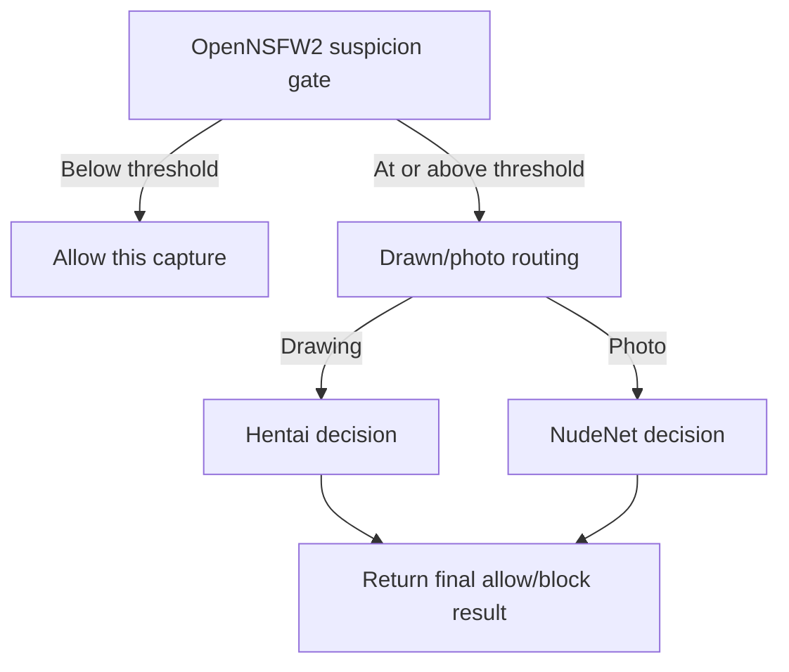

# Screen filter model APIs

This directory implements four local FastAPI inference services. It classifies
images; it does not capture windows, authenticate Sentinel control requests,
enforce lock policy, or display blockers. Those responsibilities belong to the
[monitor](../screen_monitor/README.md), [daemon](../../daemon/README.md), and
[screen blocker](../screen_blocker/README.md).

## Service boundaries

| Module in `APIs/` | Managed unit | Loopback port | Role |
| --- | --- | --- | --- |
| [openNSFW2_api.py](APIs/openNSFW2_api.py) | `sentinel-opennsfw.service` | 8000 | Suspicion gate |
| [drawn_api.py](APIs/drawn_api.py) | `sentinel-drawn.service` | 8001 | Drawing/photo routing |
| [hentai_api.py](APIs/hentai_api.py) | `sentinel-hentai.service` | 8002 | Illustrated explicit-content decision |
| [nudenet_api.py](APIs/nudenet_api.py) | `sentinel-nudenet.service` | 8003 | Photographic anatomical decision |

Unit definitions live in [`packaging/systemd/`](../../../packaging/systemd/).
They run under the `sentinel` system account using `/usr/lib/sentinel/venv`, with
`HOME=/var/lib/sentinel/image-filter`. The daemon controls service lifecycle;
an active unit is not itself proof that the model has finished loading.
See [lifecycle and readiness](../../daemon/IMAGE_FILTERING.md).

The APIs bind to `127.0.0.1`. They have no Guardian PIN or per-request application
authentication and must not be treated as the privileged Sentinel RPC interface.
Their responses are consumed by trusted local runtime components. Keep these
services off public or LAN interfaces.

## How a capture is classified



[`screen_monitor/inference.py`](../screen_monitor/inference.py) defines this
sequence. A below-threshold gate returns immediately. A gate response with
`blocked: true` means “continue classification,” not “quarantine the window.”
The routing classifier's full-image and average scores are diagnostics; its
tile vote and photo veto decide which final model to call.

## HTTP contract

Every service exposes:

- `GET /health`: JSON containing `status: "ok"` and `model_loaded: true` after
  successful model initialization. The Hentai response also identifies
  `runtime: "onnxruntime"`.
- `POST /classify`: a multipart upload with the field name `file` and an
  `image/*` content type. Images are decoded with Pillow and converted to RGB.
  Invalid image types or unreadable images return HTTP 400. Missing required
  multipart fields use FastAPI's validation response.

The response includes `timing_ms`, measuring the classification work after
image decoding. The models have different result schemas:

| API | Key response fields |
| --- | --- |
| OpenNSFW2 | `score`, `threshold`, `blocked`, `tile_scores` |
| Drawn | `prediction` (`drawing` or `photo`), `full_image`, `summary`, `tiles` |
| Hentai | `blocked`, `reason`, `full_image`, `max_tile_scores`, `summary`, `trigger`, `tiles` |
| NudeNet | `blocked`, `reason`, class maxima in `scores`, `summary`, `detections` |

Hentai's `trigger` contains the matching evidence; NudeNet detections carry class,
score, and tile/row/column metadata. Full-image NudeNet detections have no tile
index. These schemas are used by the monitor's
[`api_clients/`](../screen_monitor/api_clients/) and Activity logging.
Update consumers alongside any response-field changes.

## Preprocessing and decision rules

The constants in each API are the source of truth. Thresholds are currently
code constants, not user-adjustable CLI or Portal sensitivity settings.

### OpenNSFW2

The gate takes overlapping crops from rows 1 and 2 of its three-row grid, skipping
the top row. Each crop is resized to 256 × 256, JPEG-decoded through the
scikit-image path, center-cropped to 224 × 224, converted RGB→BGR, and has the
`[104, 117, 123]` channel means subtracted. The batch output's NSFW probability
is reduced to the maximum tile score. A score **≥ 0.85** opens the gate.

This crop layout differs from the other APIs. Do not replace it with a generic
tiler or change preprocessing without evaluating the actual model contract.

### Drawn/photo router

The model receives the full image plus nine overlapping grid crops. Inputs are
384 × 384 RGB, scaled by `1/255`, and rearranged to CHW. Output indices represent
drawn and photo scores. The decision ignores the top row of tile votes:

- A tile is drawn at a drawn score **≥ 0.90**.
- Drawing requires more drawn votes than photo votes in the remaining six tiles.
- At most one of those tiles may have a photo score **≥ 0.70**.

Otherwise the capture is routed as a photo. `average_drawn` covers all nine
tiles, including the top row; it is not the vote threshold.

### Hentai classifier

Inputs are 224 × 224 RGB with bilinear resizing, `1/255` scaling, and per-channel
mean/std of 0.5, producing normalized CHW arrays. The ONNX output is logits;
stable softmax maps the fixed labels `safe`, `suggestive`, `explicit`.
Full-image and sliding overlapping tile inputs are evaluated in one batch.

The first matching rule blocks:

| Reason | Required evidence |
| --- | --- |
| `full_image` | Full-image explicit score ≥ 0.90 and safe score ≤ 0.30 |
| `adjacent_tiles` | Two distinct neighboring tiles each explicit ≥ 0.90 and safe ≤ 0.30 |
| `very_high_tile` | One tile explicit ≥ 0.98 plus a neighboring tile explicit ≥ 0.70; both safe ≤ 0.30 |

Neighboring includes diagonal neighbors in row/column index space. This is a
sliding tiler with a nominal grid size of three and 25% overlap; the number of
tiles is not fixed to nine.

### NudeNet

NudeNet evaluates the full RGB image and sliding overlapping crops. Its detector
owns model preprocessing. Class scores are maxima across retained detections.
If any `MALE_BREAST_EXPOSED` score is **≥ 0.50**, the current implementation
removes female-breast detections before applying the final rules.

The rules are checked in this order:

| Reason | Required evidence |
| --- | --- |
| `female_genitalia` | `FEMALE_GENITALIA_EXPOSED` maximum ≥ 0.47 |
| `male_genitalia` | A tiled `MALE_GENITALIA_EXPOSED` detection ≥ 0.50 with a distinct neighboring tile detection of that class ≥ 0.20 |
| `anus` | `ANUS_EXPOSED` maximum ≥ 0.47 |
| `female_breast` | `FEMALE_BREAST_EXPOSED` maximum ≥ 0.80, raised to ≥ 0.85 when `FACE_MALE` maximum ≥ 0.50 |

Male-genital support includes diagonal neighbors and cannot be satisfied by a
full-image detection alone. The `suspicious_tiles` summary uses a separate 0.30
diagnostic threshold; it is not the final blocking rule.

## Models and packaging

Model paths are defined in [`sentinel/settings/paths.py`](../../settings/paths.py):

| Model | Installed path |
| --- | --- |
| OpenNSFW2 | `/usr/share/sentinel/models/openNSFW2_ONNX_Model/open_nsfw.onnx` |
| Drawn/photo | `/usr/share/sentinel/models/anime_real_cls/mobilenetv3_v1.4_dist/model.onnx` |
| Hentai | `/usr/share/sentinel/models/hentai-vit/model.onnx` |
| NudeNet | Resolved by `NudeDetector()` using its package/model cache |

The three explicit ONNX sessions request `CPUExecutionProvider`. Hentai runtime
preprocessing uses Pillow/NumPy and does not require PyTorch or Transformers.
All four APIs initialize their model objects at module import time. Missing or
incompatible files/dependencies can stop startup before `/health` exists.

Large model weights are excluded from the ordinary wheel. The
[`models/download_models.py`](../models/download_models.py) file is a placeholder,
not a working downloader. Follow the [Hentai staging guide](../../../packaging/models/hentai-vit/README.md)
and [third-party notices](../../../THIRD_PARTY.md) for model provenance,
verification, and redistribution. Changing label order, tensor dimensions,
preprocessing, or weights is a model integration change, not just a path change.

## Diagnostics and validation

On an existing configured installation, inspect without changing the saved
image-filtering setting:

```bash
systemctl status sentinel-opennsfw.service sentinel-drawn.service \
  sentinel-hentai.service sentinel-nudenet.service --no-pager
curl --fail --silent --show-error http://127.0.0.1:8000/health
journalctl -u sentinel-opennsfw.service -n 50 --no-pager
```

Repeat the health check on ports 8001–8003. A successful health request checks
startup, not decision accuracy. For a local endpoint smoke test, use a benign
test image you are authorized to inspect:

```bash
curl --fail --silent --show-error \
  -F 'file=@/path/to/benign-test.png;type=image/png' \
  http://127.0.0.1:8000/classify
```

Do not start a second manual API on a managed port. Use the installed service
lifecycle and [native verification guide](../../daemon/IMAGE_FILTERING.md#native-verification).

`tests/` currently contains only its package marker. The daemon's
[`test_image_filtering.py`](../../daemon/tests/test_image_filtering.py) tests
lifecycle/policy/readiness with controlled dependencies, not classifier accuracy.
For model changes, evaluate representative labeled captures, report false
positives and false negatives per branch, and compare latency and output schemas.
Then verify real capture, blocking, and rechecks in the target KDE session.
