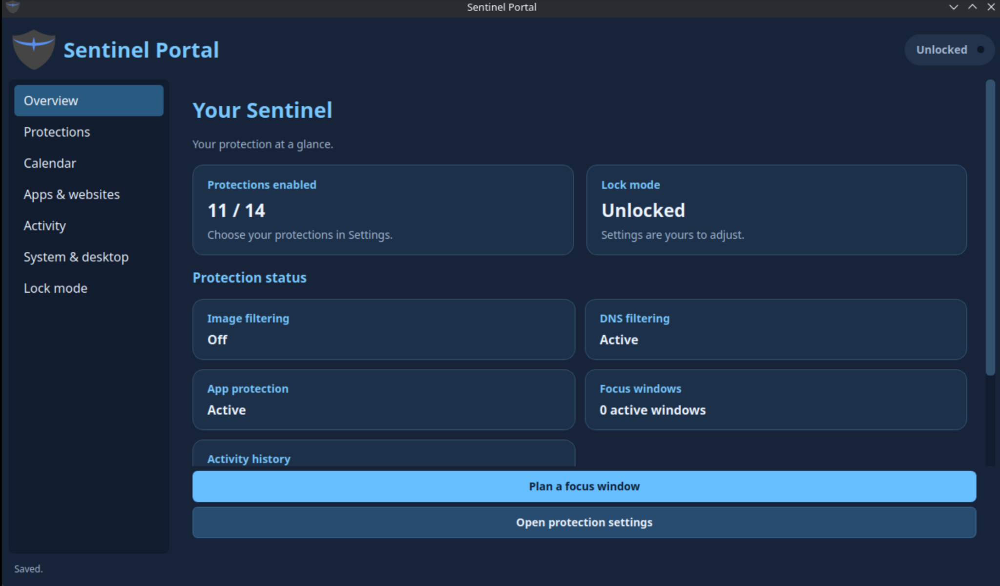
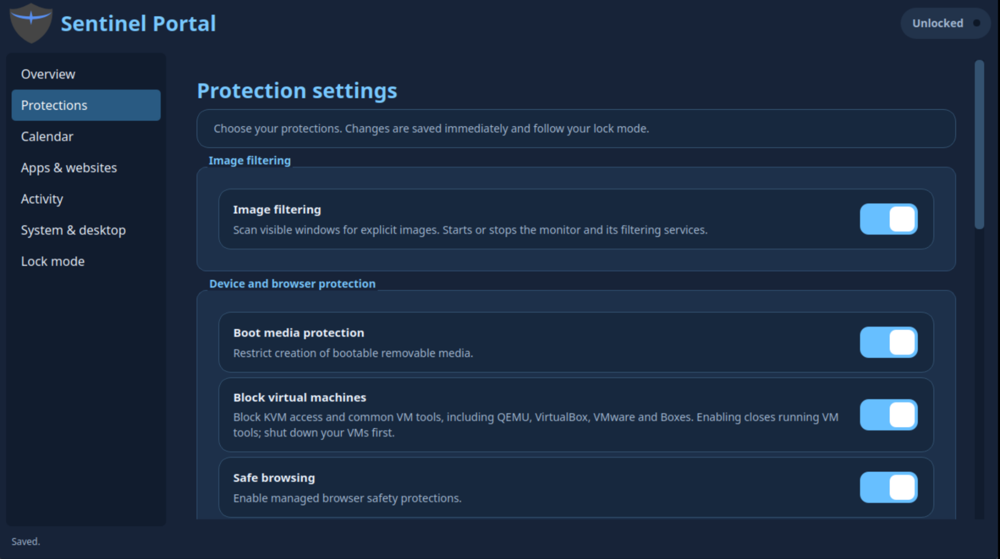
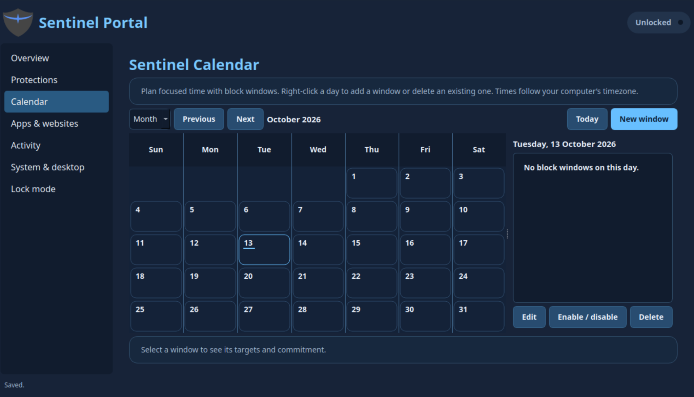
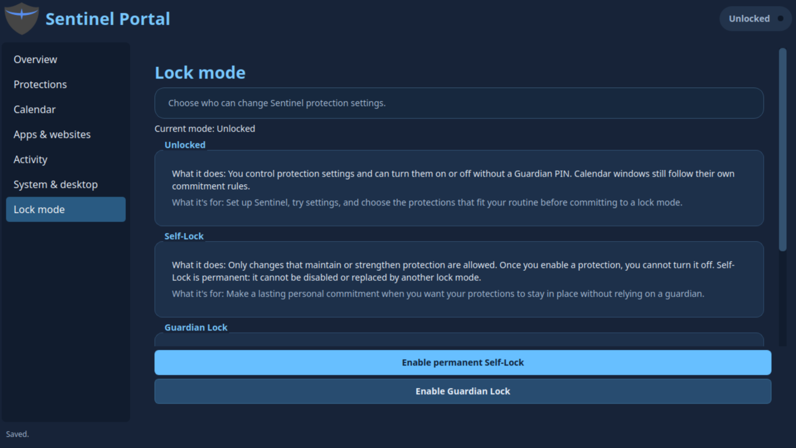
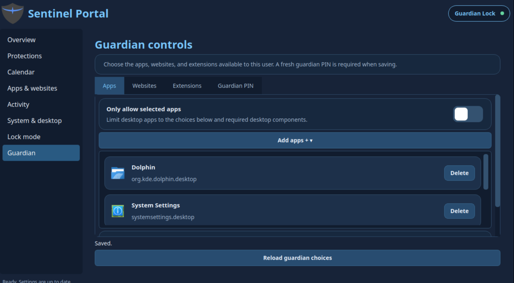

# Sentinel Portal

The native PyQt6 Portal manages the Sentinel desktop as the normal user.
The protected backend owns settings, authorization, and enforcement; the GUI
submits requests and never writes protected configuration directly.

## Screenshots

### Overview

Protection status and the current lock mode at a glance.



### Protections

Image filtering and device/browser protection settings.



### Calendar

Schedule focus windows for apps, websites, or the whole desktop.



### Lock modes

Choose Unlocked, permanent Self-Lock, or Guardian Lock.



### Guardian controls

Manage approved apps, websites, extensions, and the Guardian PIN.



## Launch

```bash
sentinel-portal
# Source GUI against the installed backend:
.venv/bin/python -m sentinel.portal.main
# Open Guardian controls when Guardian Lock is active:
sentinel-portal --guardian
```

## Pages

| Page | Controls |
| --- | --- |
| Overview | Lock mode, protection/enforcement summaries, daily allowance, and links to calendar/protections |
| Protections | Image filtering, browser/site filters, Safe Installs, boot media, and DNS toggles from the backend schema |
| Calendar | One-time or daily/weekly/monthly app, website, or whole-desktop block windows |
| Apps & websites | Personal DNS block/allow cards and app blocks with an icon/search picker |
| Activity | Stats & info (weekly usage, top apps/sites, searches) and Blocks (screen/search/site events) |
| System & desktop | Daily allowance, automatic updates/restarts/login, autostart picker, system maintenance, Chrome policy reapplication |
| Lock mode | Mode explanations, permanent Self Lock, and Guardian PIN setup |
| Self-Lock | Commitment guidance; visible only in Self Lock |
| Guardian | App, website, extension approvals and PIN changes; visible only in Guardian Lock |

Protection switches save immediately. Guardian app/website and desktop drafts
apply when saved; deleting a Guardian card edits the draft first. DNS categories
are unavailable while the DNS master switch is off. Source refresh and backend
reconciliation happen automatically, including while the Portal is closed.

The mode badge uses dark navy/light blue in both locked modes, with distinct
colored dots. Connection/save feedback appears at the bottom left. The full-color
shield is bundled in the wheel and installed as the desktop icon.

## Authorization and refresh

The Portal replaces the standalone Guardian app/website launchers. During a
backend outage, its **Guardian recovery** button opens the existing independent
PIN-protected recovery dialog. It disappears after reconnecting. Guardian app
gates keep the Portal directly launchable, including from old cached overrides.

Each new Portal window checks the lock mode before loading its pages. In
Guardian Lock, only a masked PIN entry screen appears until the backend verifies
the current Guardian PIN. Wrong PINs leave it locked; Close cancels entry.
Calendar, System and Guardian launch shortcuts use the same gate. Unlocked and
Self Lock open normally. A backend outage hides cached content; reconnecting
in Guardian Lock asks for the PIN again. An external switch into Guardian Lock
also locks an already open Portal when the next mode refresh detects it.

Entry authorization lasts only for that window; the PIN is not saved or reused.
Protected Guardian changes still ask for a fresh PIN each time, verified by the
backend. This Portal entry gate does not change CLI or companion read access.
Every entry from
Unlocked into Guardian Lock creates and confirms a new PIN, replacing any old
PIN; mismatches show a dialog without changing mode. Exit Guardian Lock with
its PIN before enabling Self Lock. There is no ordinary Self-Lock unlock path.

Settings writes include the loaded revision. Conflicts refresh authoritative
values, while failures and pending enforcement are shown separately from saved
policy. Background socket work, periodic refresh, and reconnection keep the GUI
responsive without replacing unsaved drafts. Closing waits for in-flight work,
including the independent daily-status poller. Entry points join Qt workers
before destroying the window and QApplication; test close through KDE's menu
as well as the terminal launcher.

Scheduled commitments are independent of the current machine mode: unlocked
windows remain editable, Self-Locked commitments reject weakening, and
Guardian-owned windows still require the PIN after leaving Guardian Lock.

## Calendar and picker

The calendar follows the system timezone and uses 12-hour AM/PM times. Only the
selected month's dates are drawn. Wheel scrolling changes months; click selects,
double-click edits, and date context menus create/delete windows. The day view
places overlaps side by side. Existing schedules retain their saved instants and
timezones. Repeated DST hours offer first/second choices; nonexistent times fail.
Intervals include their start and exclude their end. Monthly recurrence uses
the last available day when the original day is absent.

App/website windows combine with other active restrictions. Screen-time windows
cover every display and cannot include app/domain targets. Unlocked bypass and
Guardian PIN bypass release the current occurrence only. Self Lock offers one
two-minute extension per occurrence to disable/delete that screen-time schedule;
it does not unlock other policies. See [block windows](../../docs/block_windows.md).

**Add apps +** provides search, icons, keyboard selection, background loading,
and retry. It discovers native, Flatpak, Snap, and supported Steam launchers.
Aliases/game shortcuts using the Steam executable identify the Steam client.
Snap targets retain the instance name rather than a revision-specific path.
Guardian choices use its supported inventory and preserve required components;
shared runners and Sentinel management apps are not ordinary blocking targets.

## Daily screen-time allowance

System & desktop configures a daily limit from 00:01 to 24:00, initially off.
It counts today's recorded active desktop use, pauses during idle/locked/
suspended/screen-blocked periods, survives restarts, and resets at the saved
zone's next midnight. Overview and Activity show used/remaining time while on.

At exhaustion, the full-desktop overlay appears. Unlocked users can turn the
limit off; Guardian Lock requires the PIN. Off remains off until saved on again;
re-enabling preserves today's use and blocks immediately if already exhausted.
Self Lock normally permits tightening only, with one two-minute extension per
day to change this daily limit. Scheduled blocks remain independent.

The existing session collector must be available to measure time. Overlay
failures retry while leaving the desktop available. RPCs are `screenlimit.status`
and `screenlimit.set`; `screenblock.bypass` accepts `daily-screen-time` for the
allowance. These are separate from registered boolean settings.

## Installation and validation

Update the protected wheel and stop/restart the existing daemon as described in
[development runtime](../../README.md#development-runtime), then install the
menu launcher/icon:

```bash
sudo bash tools/install_portal.sh
QT_QPA_PLATFORM=offscreen .venv/bin/python -m pytest \
  sentinel/portal/tests sentinel/daemon/tests sentinel/appstore/tests -q
```

The installer requires the existing protected runtime. It does not bootstrap
Sentinel. `sentinel-portal.desktop` is a built-in Guardian recovery exception.
Test the installed Portal in a real KDE/Wayland session before shipping.

`desktop.status`, `browser.extensions.list`, and `appblock.catalog` provide
local presentation reads. Existing mutation endpoints remain the policy authority;
these reads do not authorize a later write. Model thresholds and daemon
supervision configuration are not Portal settings.
